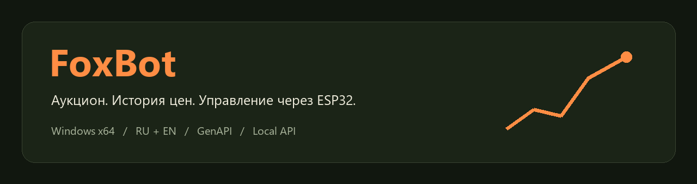
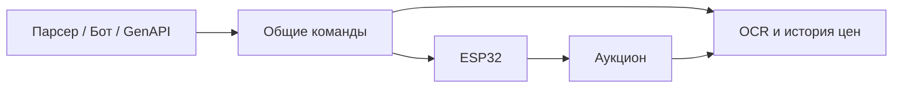

**Аукцион ArcheAge под наблюдением**

  

[Скачать](https://github.com/DiFoxenGit/FoxBot/releases/latest) · [Возможности](#features) · [Начало работы](#start) · [Ограничения](#limits) · [Обратная связь](https://github.com/DiFoxenGit/FoxBot/issues)

FoxBot — отдельное приложение для наблюдения за ценами, поиска предметов и управления аукционом через ESP32. Этот репозиторий содержит документацию и установщики. Исходный код закрыт.

## ✨ Возможности

| Режим | Что делает |
|---|---|
| Парсер | Обходит выбранные предметы, читает первую страницу по возрастанию цены и обновляет историю |
| Бот | Поиск, выбор лота и количества, покупка и проверка списания по балансу |
| Нейросеть | GenAPI, чат, системный промпт, изображения, решения через общие API-команды |
| Автоматический | Заготовка для следующих версий |

Автопоиск ESP32, график истории, фильтры, CSV/JSON, локальная веб-панель и 31 команда API. Покупки используют свежую котировку, журнал операций и проверку точной суммы списания.

## 🚀 Начало работы

1. Скачайте установщик `.exe` из [последнего релиза](https://github.com/DiFoxenGit/FoxBot/releases/latest).
2. Установите FoxBot на Windows x64. При отсутствии WebView2 установщик предложит его загрузку.
3. Подключите совместимую ESP32 с прошивкой MouseKey и выберите найденную плату.
4. Откройте аукцион на основном мониторе, задайте предмет и сначала проверьте распознавание.
5. Для GenAPI укажите свой ключ в приложении. Покупки включаются отдельно с заданным бюджетом.

**F12 — остановка управления.** Установщик пока без цифровой подписи. Контрольная сумма опубликована в `SHA256SUMS`; автоматического обновления нет.

## 🔎 Статус первой версии

Это ранняя версия 0.1.0. Начальный профиль распознавания рассчитан на русский аукцион при масштабе 100%. Реальные покупки в игре и платные запросы GenAPI ещё не проверены; тесты логики и распознавание предоставленных кадров пройдены. При неопределённом результате списания новые покупки блокируются — ручное разрешение таких случаев планируется отдельно.

Данные и компоненты

История хранится локально. Веб-панель и API слушают только loopback и защищены токеном. При использовании GenAPI сообщения и выбранные изображения отправляются провайдеру; ключ хранится через Windows DPAPI. Протокол ESP32 унаследован от MouseKey и предназначен для доверенной локальной сети.

[Конфиденциальность](PRIVACY.md) · [Условия использования](LICENSE) · [Лицензии компонентов](docs/THIRD_PARTY_NOTICES.md) · [Изменения](CHANGELOG.md)

## English

FoxBot is a Windows desktop auction assistant with ESP32 input, OCR, local price history, a watchlist parser, local API and optional GenAPI integration. Source code is private; this repository distributes documentation and installers. Version 0.1.0 is an early release with a Russian 100% auction UI recognition profile. Live trades and paid GenAPI calls have not been validated. Downloads are unsigned; updates are manual.

© 2026 DiFoxen · FoxBot

